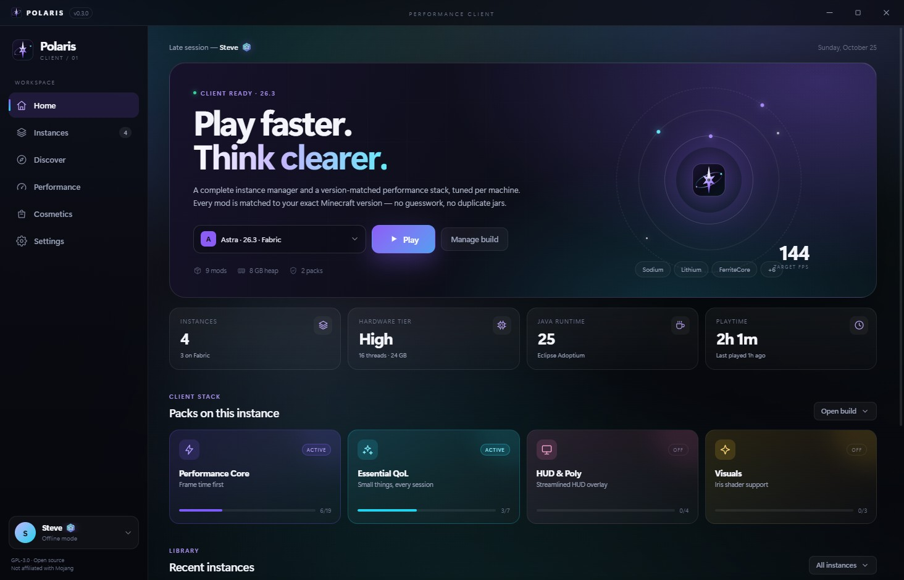
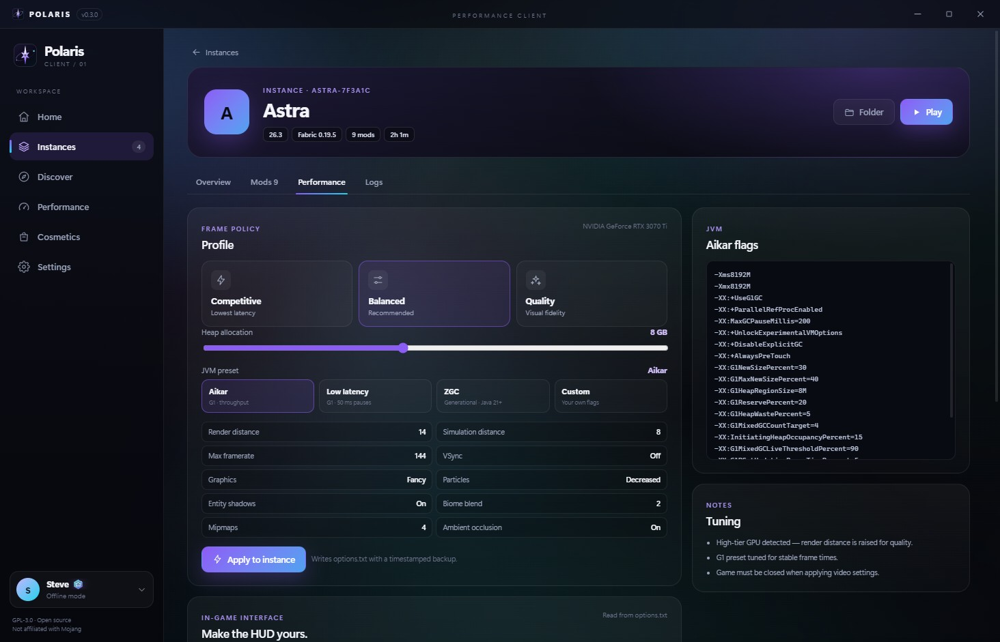
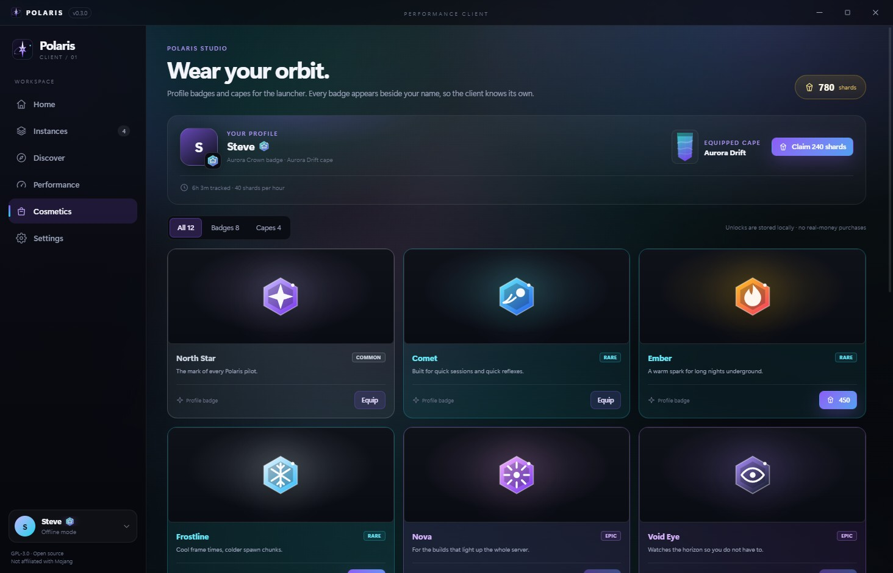
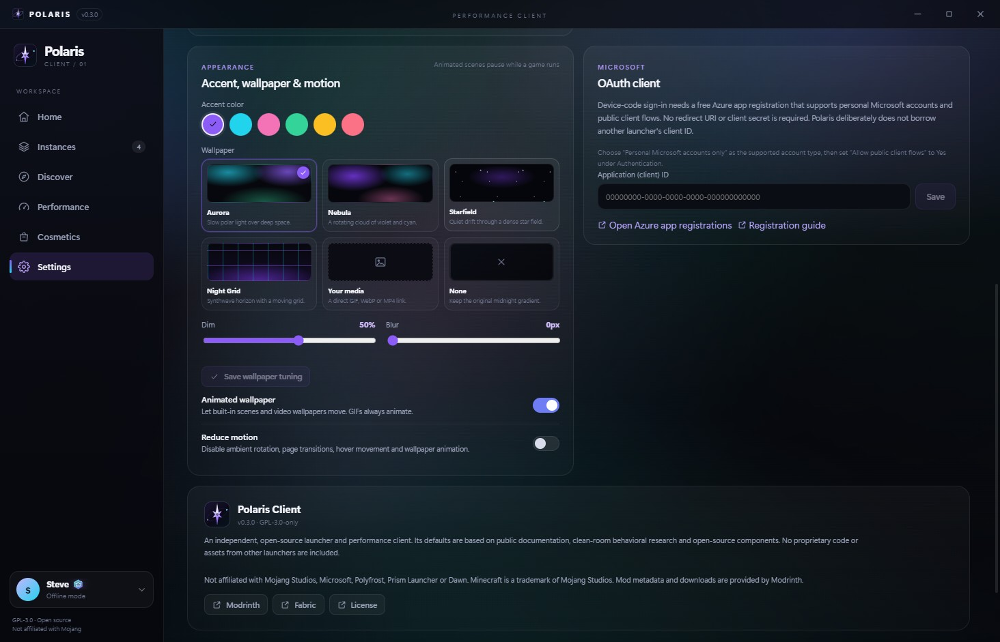

# Polaris Client

A performance-first Minecraft launcher and client platform for Windows, with Linux builds from
source. Polaris combines a Prism-style instance manager with a hardware-aware performance stack,
Modrinth discovery, local cosmetics, and a customization layer for both the launcher and the game.

- **Instances** — isolated game directories, per-instance memory, Java, JVM arguments and performance profiles. Vanilla, Fabric and headless dedicated servers are supported.
- **Modpacks** — browse Modrinth modpacks and install a release as a new instance: required files, optional files, `.mrpack` overrides and a persisted pack reference. Client and server packs can carry hardware gates such as `requires: nvidia`; skipped mods keep a reason.
- **Version-matched modding** — curated Performance, server, QoL, HUD and Visual stacks resolve through Modrinth, install dependencies, and skip anything that does not support the instance's exact Minecraft version. Mods can only be installed into Fabric instances.
- **Project pages and updates** — search with sort and category filters, open gallery/description pages, pick any compatible release, and update every tracked mod with one batch hash lookup.
- **Hardware-aware tuning** — CPU/GPU/RAM/Java detection assigns one of four tiers and produces Competitive, Balanced or Quality plans. Plans write a timestamped backup of `options.txt` and generate Aikar, low-latency G1 or Generational ZGC JVM flags.
- **Cosmetics** — a 12-item local store with eight badges and four capes, funded by playtime shards: 900 to start, then 40 per tracked hour. One badge and one cape can be equipped and the icon appears next to your profile name. There is no checkout, paid currency or loot box.
- **Appearance** — launcher wallpapers (aurora presets, animated gradients, and direct GIF/WebP/MP4 links), accent colors and motion controls. The in-game panel writes whitelisted vanilla `options.txt` keys for GUI scale, FOV, brightness, chat opacity and scale, screen effects, and the attack indicator, with a timestamped backup first.
- **Launcher discipline** — optionally minimize the launcher and lower its process priority while Minecraft runs, pause launcher animations, and hard-link official launcher caches to save bandwidth and disk.
- **Accounts** — offline accounts work out of the box. Microsoft sign-in uses the device-code flow with an Azure public-client ID that you supply, so Polaris never ships or borrows an OAuth client.
- **Polaris identity** — an original four-point star mark used by the app icon, title bar, renderer and showcase site. `build/icon.svg` is the source; `npm run icons` regenerates the PNG and ICO.
- **Clean-room UI** — Electron 33, React 19 and TypeScript with a context-isolated preload bridge.



## Status

Polaris is at **0.3.1** (the Aurora update). Installation, Fabric mod loading, launching, log capture, mod install/remove/toggle, curated packs, update checks, `.mrpack` modpack planning, dedicated server launch, performance plans, `options.txt` writes, the cosmetics store, launcher appearance and the in-game options panel are implemented. Core logic is covered by unit tests. Game installation and Fabric loading have been exercised against live Minecraft 26.3; modpack and server flows should be treated as new in this release.

Known gaps:

- Microsoft sign-in needs a user-supplied Azure client ID and Mojang's Minecraft Services authorization; unapproved apps can receive `403 Invalid app registration` (offline mode needs nothing).
- Modpacks and mods are Fabric-only. Quilt, Forge and NeoForge packs are rejected rather than half-installed.
- Dedicated servers are managed locally by this launcher; there is no remote panel or multi-user management.
- Cosmetics live in the local profile. The equipped badge and cape appear next to your name inside Polaris; **other players seeing them in-game is not shipped**. That needs a shared backend or a companion relay/mod and is roadmap, not a current claim.
- Animated wallpapers apply to the launcher. The in-game panel only edits vanilla `options.txt`; no UI mods are injected, and an animated in-game wallpaper would need a client mod, so it is roadmap.
- Windows 10/11 is the primary target. Linux packaging is available from source (`npm run dist:linux`) and CI builds an AppImage, but Linux runtime support is experimental. macOS is untested.
- The Windows installer and portable build are unsigned, so SmartScreen may warn. Verify the published SHA-256 before running the file, and sign with a certificate you control before wide distribution.

## Screenshots

| Home | Per-instance performance |
| --- | --- |
|  |  |

| Cosmetics | Appearance |
| --- | --- |
|  |  |

The full gallery, including animated-wallpaper and in-game-panel shots, is available locally. The screenshots are captured from the renderer mock, so no real account data is shown.

## Getting started

Requirements: Windows 10/11 for the primary installer, Node.js 22 or newer, and a Java runtime for the Minecraft version you want to play. Java 21 is the floor; Minecraft 26.x requires Java 25, and Polaris selects the closest compatible runtime it finds. Linux builds use Node 22 on Linux or WSL2 and are experimental.

```powershell
npm.cmd install
npm.cmd run dev             # development app
npm.cmd run test            # unit tests
npm.cmd run typecheck
npm.cmd run build           # production bundles into out/
npm.cmd run dist            # current platform: installer on Windows, AppImage on Linux
npm.cmd run dist:win        # unsigned NSIS installer: dist/Polaris-Setup-0.3.1.exe
npm.cmd run dist:win:portable
npm.cmd run dist:linux      # Linux AppImage (run on Linux or WSL2)
npm.cmd run icons           # regenerate the PNG/ICO icon set from build/icon.svg
```

`npm.cmd` is used in the examples because PowerShell may block `npm.ps1`. On Linux and WSL2, use `npm run ...` instead. For the full Windows, Linux, WSL2 and GitHub Actions instructions, see [docs/BUILDING.md](docs/BUILDING.md).

### Windows installer

`npm.cmd run release:win` builds the NSIS installer, copies it to `site/public/downloads/Polaris-Setup.exe`, writes the SHA-256 manifest, and rebuilds `out/site`. The installer is per-user (no administrator prompt), unsigned, and registers an uninstaller in Windows Apps & features. Because it is unsigned, SmartScreen may ask you to confirm; verify the SHA-256 shown in `downloads/latest.json` first.

### Linux builds

`npm run dist:linux` on Linux or WSL2 builds an AppImage from the same source. The Linux path discovers Java in common package-manager, SDKMAN, Gradle and jlink locations, reads the GPU name through `lspci` with an `nvidia-smi` fallback, and uses a graceful SIGTERM/SIGKILL stop for game and server processes. It is still experimental compared with the Windows path. The GitHub Actions workflow is configured to build and upload the Linux artifact on Ubuntu.

### Isolating test data

Set `POLARIS_HOME` to keep test data away from your normal launcher data:

```powershell
$env:POLARIS_HOME = "C:\polaris-test"
npm.cmd run dev
```

Without `POLARIS_HOME`, Polaris stores data in `%APPDATA%\Polaris` on Windows and `~/.config/Polaris` on Linux. On Windows, a `portable.txt` file next to a packaged executable switches storage to a `data` folder next to the executable.

## Cosmetics and appearance

Cosmetics are deliberately local-first:

- Shards live in `settings.json` alongside owned items and the equipped badge/cape. There is no economy server, checkout, or way to buy shards in this build.
- The store is a normal page with the same catalog and prices for every account; it is not a hidden admin screen.
- The equipped badge/cape is stored in the local settings and appears next to the profile name in the launcher. Cross-player visibility in Minecraft requires shared infrastructure that is not part of 0.3.1.

Launcher appearance supports wallpaper presets, an animated aurora, direct GIF/WebP/MP4 wallpaper links, dim/blur tuning, accent colors and reduced-motion behavior. The in-game options panel is a careful writer, not a mod injector: it only edits whitelisted vanilla keys in `options.txt`, creates a timestamped backup before writing, and asks you to close the game first. In-game animated wallpapers are not faked.

## Microsoft accounts

Polaris deliberately does not ship a Microsoft OAuth client. To enable Microsoft sign-in:

1. Register an application in the Azure portal (**App registrations** > **New registration**).
2. Choose support for **personal Microsoft accounts**.
3. Under **Authentication**, enable **Allow public client flows**. Device-code sign-in needs no redirect URI and no client secret.
4. Copy the **Application (client) ID** into **Settings** > **Account**.

Polaris then requests `XboxLive.signin offline_access`, exchanges the Microsoft token for Xbox Live and Minecraft services tokens, and stores the account locally. Refresh tokens stay in `accounts.json` on your machine.

**Important:** Minecraft Services checks third-party applications against an allow list. A fresh Azure app can pass Microsoft and Xbox authentication and still receive `403 Invalid app registration` at the Minecraft login step. Apply through [aka.ms/AppRegInfo](https://aka.ms/AppRegInfo) and wait for approval before expecting online play. Polaris does not reuse another launcher's client ID, session tokens, or account files; doing so would impersonate that application and violate Microsoft/Mojang's terms.

## Data layout

```
<Polaris home>/
  settings.json           launcher settings, appearance, cosmetics and shard balance
  accounts.json           offline and Microsoft accounts (tokens included)
  instances/<id>/         one isolated game or server directory per instance
    instance.json         instance configuration (kind, memory, port, EULA, pack reference)
    mods/                 Fabric mods (disabled mods use .disabled)
    mods/.polaris-index.json  installed project/version/hash index for update checks
    logs/latest.log       launcher-captured game or server output
  meta/                   Mojang version manifests
  versions/               installed version metadata
  libraries/ assets/      shared game files
  java/                   runtimes detected or chosen in Settings
  cache/ downloads/       download cache
```

## Architecture

Polaris runs a Node.js core in Electron's main process and a sandboxed React renderer:

- `src/core` — installation, version merging, argument construction, game/server launch lifecycle, performance and JVM planning, `options.txt` read/write, cosmetics, Modrinth access, mod/pack management, `.mrpack` parsing and extraction, dedicated-server runtime setup, accounts and filesystem guards.
- `src/main` — service composition, IPC handlers, window lifecycle and launcher discipline.
- `src/preload` — the only bridge between renderer and main (`contextBridge`, `sandbox: true`, `nodeIntegration: false`).
- `src/renderer` — React UI and the polished appearance surfaces. A mock API in `src/renderer/src/mock.ts` lets the UI run in a plain browser for design work and screenshots.
- `src/shared` — types, curated pack definitions, the cosmetics catalog, appearance presets and IPC channel names shared by both sides.
- `site` — the standalone static showcase. No renderer code is imported by the site.
- `build/icon.svg` — the original Polaris mark; `scripts/render-icons.cjs` generates the icon set.

See [docs/ARCHITECTURE.md](docs/ARCHITECTURE.md) for the launch lifecycle, performance policy and security model, and [docs/BUILDING.md](docs/BUILDING.md) for Windows installer, Linux, WSL2 and CI packaging instructions.

## Reference lineage and licensing

Polaris is an independent, GPL-3.0-only project. It learned from public behavior and open-source projects but contains no code or assets from proprietary launchers:

- **Prism Launcher** (GPL-3.0) informed instance management concepts.
- **Modrinth App / theseus** informed the discovery and project-page experience.
- **Polyfrost OneLauncher / OneClient** (GPL-3.0) informed the curated HUD and quality-of-life stack. The mods themselves are downloaded at runtime from their own projects.
- **Dawn** is a proprietary client used only as a clean-room behavioral reference for performance defaults. No Dawn code, assets or branding are used.
- **[REA](https://github.com/morluto/rea)** (MIT) is an agent-driven reverse-engineering toolkit. It was evaluated as a possible clean-room research workflow, but is not a launcher component, is not bundled, and no REA code is included.

See [docs/ATTRIBUTION.md](docs/ATTRIBUTION.md) and [NOTICE](NOTICE) for details.

Polaris is not affiliated with Mojang Studios, Microsoft, Polyfrost, Prism Launcher or Dawn. Minecraft is a trademark of Mojang Studios. Mod metadata and downloads are provided by Modrinth.

## License

GPL-3.0-only. See [LICENSE](LICENSE).